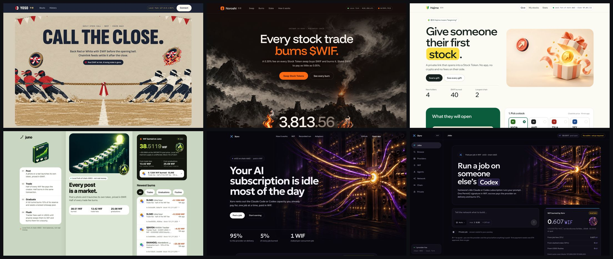
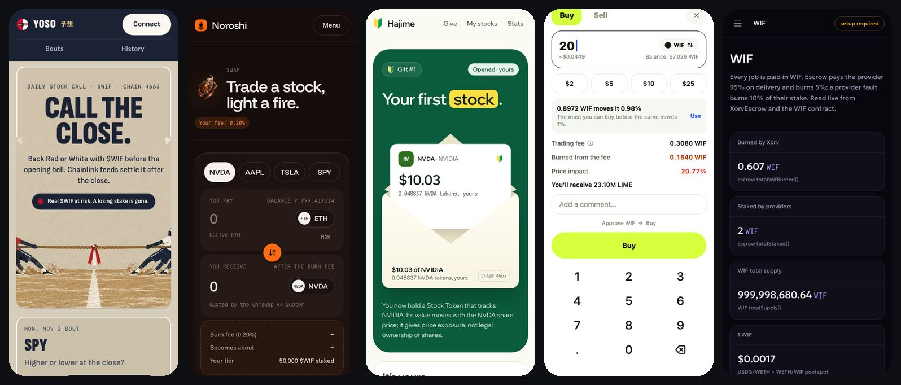
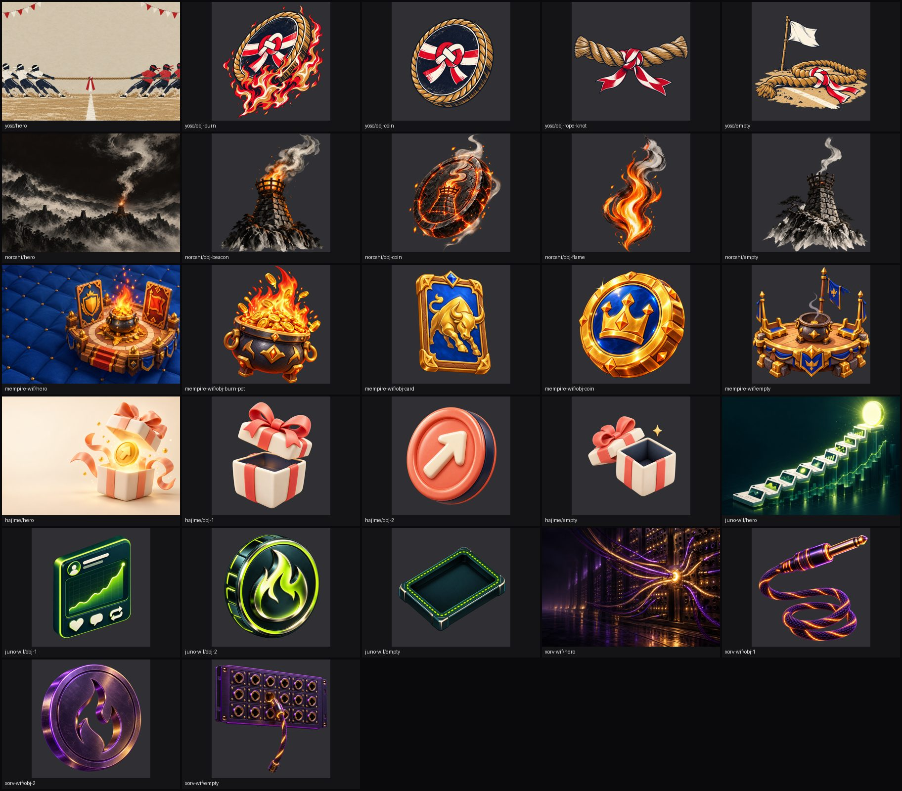
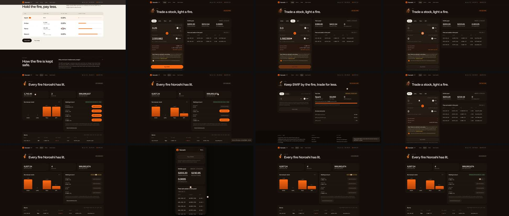

# nick-skills

Claude Code skills from a solo builder who ships to hackathons every week. They're the working loops behind six
hackathon entries judged, polished and filmed in one day, with the human approving each round from a phone.

## /judge-skill

Judge, fix and film a whole batch of products in rounds that a human signs off one at a time.

```
 round 0  judge + fix (non-UI)   cheap coding model, two lanes    -> scorecards + commits
 round 1  UI judge + art + fix   one design agent per product      -> every screen at 1440 and 375, one gallery link
 round 2  raw walkthrough        one recording agent per product   -> a 6–10 min unedited take + chapter list
 round 3  the cut                the human's notes -> ~3 min film   -> the submission video
```

### Round 1: every screen judged, generated art wired in, then a gallery



The same pass at phone width:



Each product gets its own art direction, generated headlessly with the Codex CLI's image tool:



### Round 2: one raw take per product

A real run of the real product, made through its UI, with a visible cursor. There's no narration and no cuts.
It ships with a chapter list of every transaction, so the human picks the cut.



## Install

```bash
git clone https://github.com/nickthelegend/nick-skills
ln -s "$PWD/nick-skills/skills/judge-skill" ~/.claude/skills/judge-skill
```

Then, in Claude Code: `/judge-skill` with a list of repos and the event rules.

Needs: Claude Code; the [Codex CLI](https://github.com/openai/codex) for round 0 and the art; Playwright and ffmpeg
for screenshots and recordings; Python 3 with Pillow for the gallery and contact sheets.

## What's inside

| Path | What it is |
|---|---|
| [skills/judge-skill/SKILL.md](skills/judge-skill/SKILL.md) | The loop, round by round, with the rules that kept it safe |
| [skills/judge-skill/briefs/](skills/judge-skill/briefs/) | Worker briefs for rounds 0–3, with placeholders for your paths and event rules |
| [skills/judge-skill/scripts/](skills/judge-skill/scripts/) | Codex judge lanes, headless art generation, contact sheets, gallery builder |

## Lessons baked in

- **Check every worker at five minutes.** One day a broken tool hook left every agent stuck for hours and
  nobody noticed. A one-line `git status` per repo would have caught it.
- **Keep working files on persistent disk.** A power cut wiped five half-finished recordings that lived in a
  temp folder.
- **Review cheap-model diffs for deleted tests and gutted config.** It happened to us twice in one day.
- **Hold to 3–4 heavy workers on 16 GB.** Each runs a chain fork, a dev server and a browser.
- **Keep same-event products distinct.** They should never look like one team made them.

## License

MIT © 2026 Nivesh Gajengi
